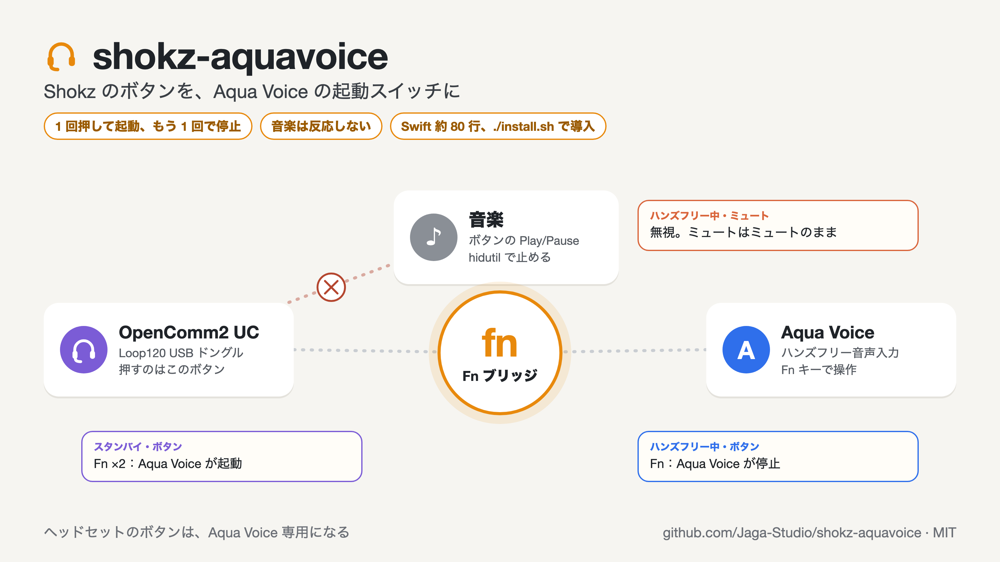
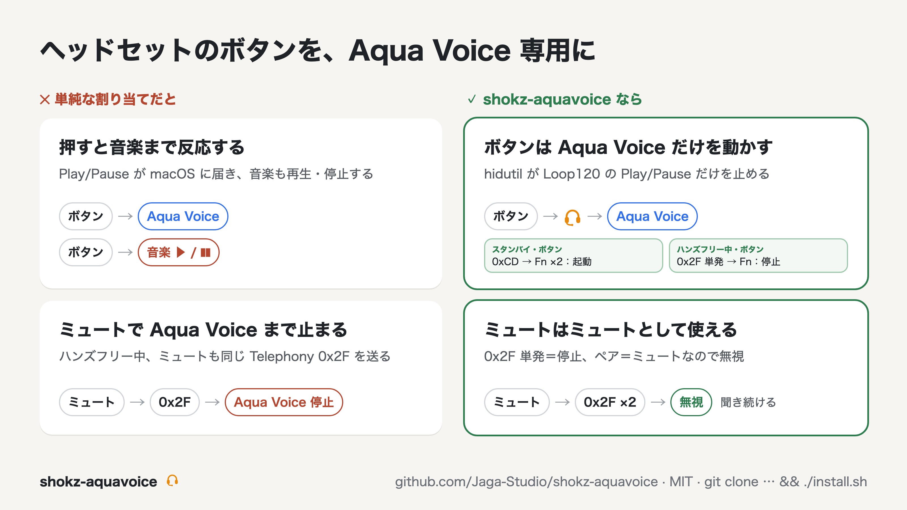
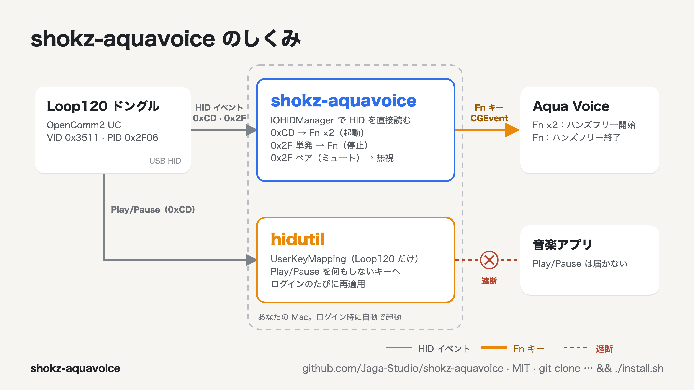

# shokz-aquavoice

[English README](README.md)



Shokz **OpenComm2 UC**（Loop120 USBドングル）のマルチファンクションボタンを、
[Aqua Voice](https://aqua-voice.com/)（AI音声入力）の起動・停止トリガーに変換する macOS デーモンです。

ボタン1回押しでハンズフリーモードが起動、もう1回で停止。
純正のPlay/Pause・ミュート動作はmacOSに届かない（または無視される）ので、
ヘッドセットのボタンは**Aqua Voice専用操作**になります。



## ボタン動作マップ

| ボタン | 状態 | Loop120が送るHIDイベント | デーモンの動作 |
|---|---|---|---|
| マルチファンクション | スタンバイ | Consumer `0xCD`（Play/Pause）press | Fnキー×2 → **Aqua Voice起動** |
| マルチファンクション | ハンズフリー中 | Telephony `0x2F` 単発（val=0） | Fnキー×1 → **Aqua Voice停止** |
| ミュート | スタンバイ | （送信なし） | — |
| ミュート | ハンズフリー中 | Telephony `0x2F` ペア（val=1→0） | **無視**（ミュート本来の動作は残る） |

## 仕組み



- `IOHIDManager` でLoop120（VendorID `0x3511` / ProductID `0x2F06`）のraw HIDイベントを監視
- `0xCD` press で `CGEvent` のFnキーを2連打（Aqua Voiceのハンズフリー起動ショートカット）
- `0x2F` は**送信パターンで区別**：単発＝マルチファンクション→Fn、val=1→0ペア＝ミュート→無視
  （両方とも同じTelephony usageなので、イベント列の形で見分けています）
- デーモンはイベントを「覗き見」するだけでmacOSへの配信は止めないため、
  Play/Pauseは別途 `hidutil` で**Loop120限定**に無効キーへリマップして遮断
  （デーモンはrawイベントを拾い続けるので動作は変わりません）

Karabiner-Elementsでは Consumer Control は捕捉できるものの Telephony HID に非対応なため、
起動はできても停止ができません。専用デーモンにしたのはそのためです。

## 必要なもの

- macOS + Xcode Command Line Tools（`swiftc` が使えればOK）
- Shokz OpenComm2 UC + Loop120 USBドングル
- Aqua Voice（Fnダブルタップでハンズフリーが起動する設定）
  - [Typeless](https://www.typeless.com/) でも、そのまま使えます（Dictate のショートカットが Fn のままなら、設定やコードの変更なしでボタンで開始・停止できます）

## インストール

```sh
git clone https://github.com/Jaga-Studio/shokz-aquavoice.git
cd shokz-aquavoice
./install.sh
```

`install.sh` がやること：

1. `main.swift` を `swiftc` でビルド
2. `codesign` で署名（後述）
3. `~/.local/bin/shokz-aquavoice` にインストール
4. 2つのLaunchAgentを `~/Library/LaunchAgents/` に登録・ロード
   - `com.shokz.aquavoice` — デーモン本体（ログイン起動＋KeepAlive）
   - `com.shokz.playpause-block` — 起動時にhidutilリマップを再適用（再起動で消えるため）
5. hidutilリマップを即時適用

### 署名について

デフォルトはアドホック署名（`codesign -s -`）。
**アドホック署名だとmacOSのTCC権限がビルド毎のcdhashに紐付く**ため、
再ビルドのたびに権限を付け直す必要があります。

Apple開発者証明書があれば、それで署名すると権限が証明書ベースになり再ビルドしても維持されます：

```sh
SIGN_IDENTITY="Apple Development: Your Name (TEAMID)" ./install.sh
```

## 権限の付与（初回のみ）

システム設定 → プライバシーとセキュリティ で `shokz-aquavoice` に以下を付与：

- **入力監視** — HIDイベントの受信に必要
- **アクセシビリティ** — Fnキーイベントの送信に必要
  （最近のmacOSではこのペイン名が **「デバイスの制御とデータのアクセス」** になっています）

権限付与後、ボタンを押して Aqua Voice が起動すれば成功です。
ログは `/tmp/shokz-aquavoice.log` に出ます（`[START]` / `[STOP]` / `[SKIP]`）。

## 別モデル（Loop110等）で使う場合

ProductIDが違うので2箇所を書き換えてください：

1. `main.swift` の `productID`
2. `launchagents/com.shokz.playpause-block.plist` の `ProductID`（10進数）

確認コマンド：`ioreg -r -c IOHIDDevice -l | grep -A5 "Shokz"`

## アンインストール

```sh
./uninstall.sh
```

デーモン・両LaunchAgent・hidutilリマップをすべて解除します。

## 注意点・制限

- Aqua Voice と Typeless を両方起動していると、どちらも Fn で動くため、ボタン1回で両方が反応します。使う方だけを起動してください
- ごく稀に、マルチファンクションボタンの停止操作が「ペア送信」されてミュート判定になる可能性があります。その場合はもう一度押してください
- この使い方では Mac との Bluetooth ペアリングを削除してドングルのみで接続する前提のため、Macへの通話着信をヘッドセットのボタンで応答することはできません
- `hidutil` のリマップは再起動で消えるため、`com.shokz.playpause-block` がログイン時に再適用します。削除した場合は再起動後にPlay/Pauseが復活します

## 解説記事

- ブログ（セットアップ手順・レビュー）: https://jaga-farm.com/shokz-opencomm2-uc-2025-upgrade/
- note: https://note.com/jaga_farm/n/nee6c8143459c

## License

MIT
