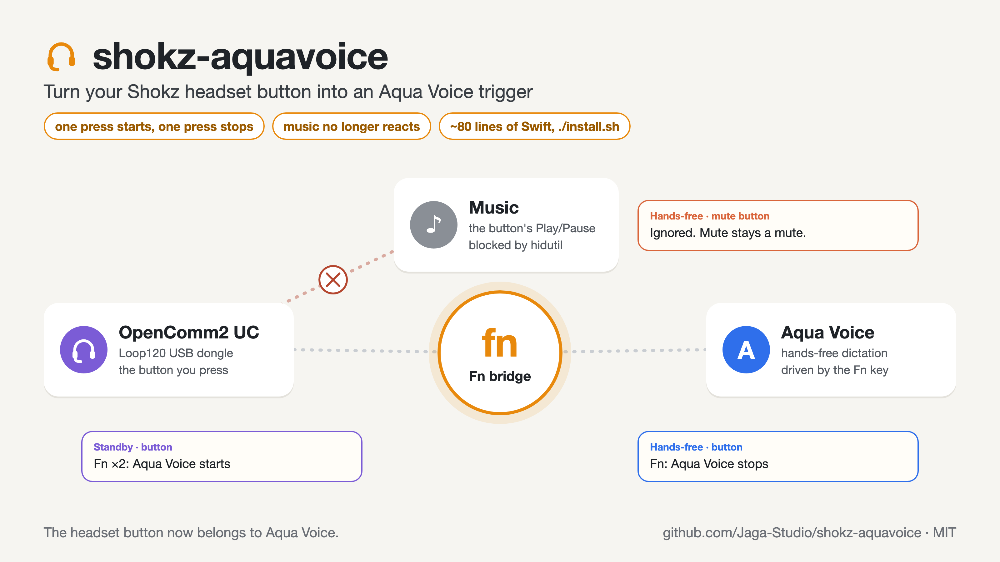
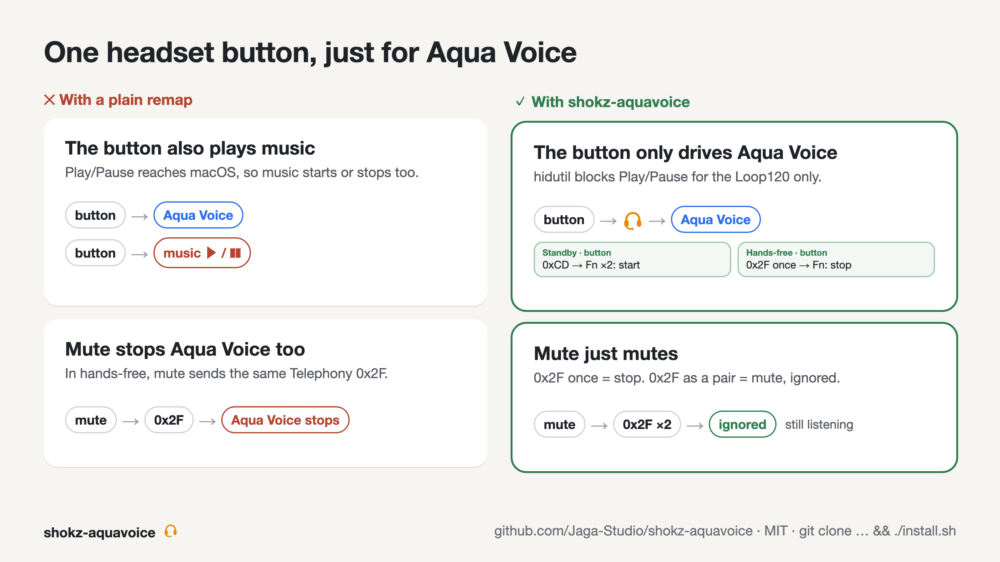
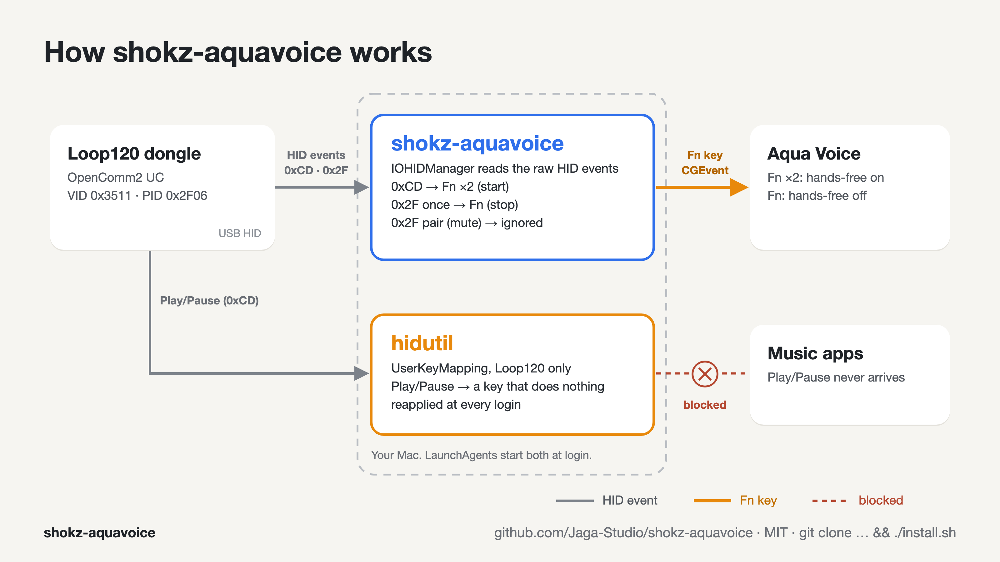

# shokz-aquavoice

[日本語の README はこちら](README.ja.md)



A macOS daemon that turns the multifunction button of the Shokz **OpenComm2 UC** (Loop120 USB dongle)
into a start/stop trigger for [Aqua Voice](https://aqua-voice.com/) (AI voice dictation).

Press the button once to start hands-free mode, press it again to stop.
The stock Play/Pause and mute actions never reach macOS (or are ignored),
so the headset button becomes **an Aqua Voice-only control**.



## Button map

| Button | State | HID event sent by the Loop120 | What the daemon does |
|---|---|---|---|
| Multifunction | Standby | Consumer `0xCD` (Play/Pause) press | Fn key ×2 → **start Aqua Voice** |
| Multifunction | Hands-free | Telephony `0x2F`, single (val=0) | Fn key ×1 → **stop Aqua Voice** |
| Mute | Standby | (nothing sent) | — |
| Mute | Hands-free | Telephony `0x2F`, pair (val=1→0) | **Ignored** (the mute itself still works) |

## How it works



- `IOHIDManager` watches the raw HID events of the Loop120 (VendorID `0x3511` / ProductID `0x2F06`)
- On a `0xCD` press, it taps the Fn key twice through `CGEvent` (Aqua Voice's hands-free start shortcut)
- `0x2F` is **told apart by its send pattern**: a single event = multifunction → Fn; a val=1→0 pair = mute → ignored
  (both use the same Telephony usage, so the shape of the event sequence is what separates them)
- The daemon only "peeks" at events and does not stop macOS from delivering them,
  so Play/Pause is blocked separately: `hidutil` remaps it to a no-op key **for the Loop120 only**
  (the daemon keeps receiving the raw events, so its behavior does not change)

Karabiner-Elements can capture Consumer Control but does not support Telephony HID,
so it can start Aqua Voice but cannot stop it. That is why this is a dedicated daemon.

## Requirements

- macOS + Xcode Command Line Tools (anything that provides `swiftc`)
- Shokz OpenComm2 UC + Loop120 USB dongle
- Aqua Voice (set so that a Fn double tap starts hands-free)
  - [Typeless](https://www.typeless.com/) works too, as-is — as long as its Dictate shortcut stays on Fn, the button starts and stops dictation with no settings or code changes

## Install

```sh
git clone https://github.com/Jaga-Studio/shokz-aquavoice.git
cd shokz-aquavoice
./install.sh
```

What `install.sh` does:

1. Builds `main.swift` with `swiftc`
2. Signs it with `codesign` (see below)
3. Installs it to `~/.local/bin/shokz-aquavoice`
4. Registers and loads two LaunchAgents in `~/Library/LaunchAgents/`
   - `com.shokz.aquavoice` — the daemon itself (starts at login + KeepAlive)
   - `com.shokz.playpause-block` — reapplies the hidutil remap at login (a reboot clears it)
5. Applies the hidutil remap right away

### About signing

The default is ad hoc signing (`codesign -s -`).
**With ad hoc signing, macOS TCC permissions are bound to each build's cdhash**,
so you have to grant the permissions again after every rebuild.

If you have an Apple developer certificate, sign with it: the permissions become certificate-based and survive rebuilds:

```sh
SIGN_IDENTITY="Apple Development: Your Name (TEAMID)" ./install.sh
```

## Granting permissions (first time only)

In System Settings → Privacy & Security, give `shokz-aquavoice`:

- **Input Monitoring** — needed to receive HID events
- **Accessibility** — needed to send Fn key events
  (on recent macOS this pane is named **「デバイスの制御とデータのアクセス」** in Japanese)

After granting them, press the button: if Aqua Voice starts, you are done.
Logs go to `/tmp/shokz-aquavoice.log` (`[START]` / `[STOP]` / `[SKIP]`).

## Using another model (Loop110, etc.)

The ProductID differs, so change it in two places:

1. `productID` in `main.swift`
2. `ProductID` (decimal) in `launchagents/com.shokz.playpause-block.plist`

To check it: `ioreg -r -c IOHIDDevice -l | grep -A5 "Shokz"`

## Uninstall

```sh
./uninstall.sh
```

Removes the daemon, both LaunchAgents and the hidutil remap.

## Notes and limitations

- If Aqua Voice and Typeless are both running, both respond to Fn, so a single button press triggers both — run only the one you are using
- Very rarely, a multifunction-button stop may arrive as a "pair" and be treated as mute. If that happens, press the button again
- This setup assumes you remove the headset's Bluetooth pairing with the Mac and connect through the dongle only, so you cannot answer incoming Mac calls with the headset button
- The `hidutil` remap is cleared by a reboot, so `com.shokz.playpause-block` reapplies it at login. If you remove it, Play/Pause comes back after a reboot

## Articles (Japanese)

- Blog (setup steps and review): https://jaga-farm.com/shokz-opencomm2-uc-2025-upgrade/
- note: https://note.com/jaga_farm/n/nee6c8143459c

## License

MIT
